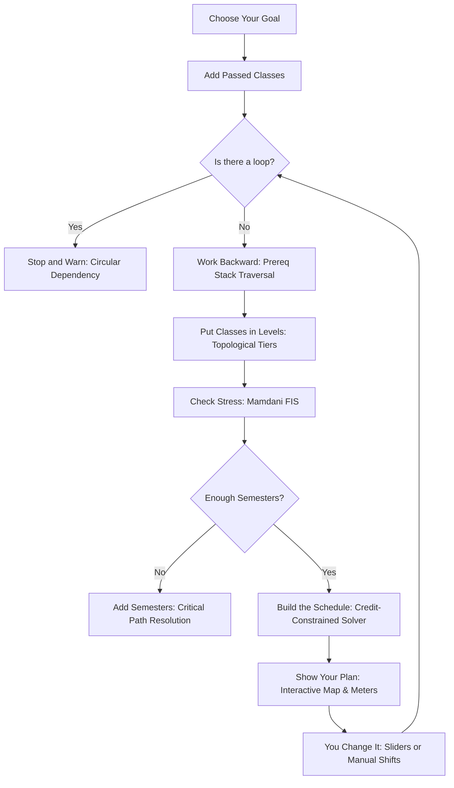

# CourseAdvisor

> **Intelligent Academic Planning Engine**  
> Document ID: `ARCH-2026-v2.1` | Classification: Confidential / Official

CourseAdvisor is an intelligent academic planning application designed to calculate optimal, personalized semester class schedules. Unlike traditional static degree-audit tools, CourseAdvisor uses a dual-engine architecture:
1. **Backward Chaining Inference Engine** operating over a **Directed Acyclic Graph (DAG)** of prerequisite trees.
2. **Mamdani Fuzzy Inference System (Workload Scoring)** translating student confidence ratings into safe credit bounds and stress indices.

---

## 🌟 Key Features

- **Backward Chaining Prerequisite Solver**: Select a career specialization (e.g., *AI & Machine Learning Engineer*, *Full-Stack Systems Architect*, *Cybersecurity Specialist*, or *Big Data Architect*) or any capstone course ($V_{target}$), and the engine traverses backwards to automatically identify all required dependencies.
- **Transcript Integration**: Enter passed courses; the engine satisfies prerequisites and automatically skips them from future terms.
- **Topological Tier Assignment & Kahn's Algorithm**: Arranges prerequisite courses into sequential levels (Tier 0 to Tier $N$).
- **Mamdani Fuzzy Workload & Stress Engine**:
  - Inputs: Student Confidence ($C \in [1, 10]$) across Math, Coding, Systems, and Theory, plus Subject Difficulty ($D \in [1, 10]$).
  - Evaluates triangular and trapezoidal membership distributions across 9 fuzzy rules.
  - Applies Centroid Defuzzification to compute crisp Max Recommended Credit Bounds (12–18 hrs) and Semester Stress Index (0–100%).
- **Interactive Prerequisite DAG Visualizer**: Pan, zoom, and inspect course nodes. Clicking any course highlights upstream prerequisites and downstream dependent courses.
- **Semester Stress Meter**: Real-time radial arc gauge with color-coded safety indicators (Green: Balanced, Amber: Challenging, Red: Overload Risk).
- **Transparent Reasoning Cards**: Explains why each course was placed in a specific semester and which downstream courses it unlocks.
- **Edge Case Protection**:
  - **Loop / Circular Dependency Interception**: Detects cycles ($A \leftrightarrow B$) with cycle path tracing to prevent recursion failure.
  - **Unsatisfiable Goal / Critical Path Check**: Automatically alerts students if their desired graduation timeline is shorter than the physical Critical Path Length.
- **Offline-First Persistence**: Persists student settings, confidence sliders, and transcripts locally via `localStorage`.

---

## 🚀 Getting Started

### Prerequisites
- Node.js (v18+)
- npm

### Installation & Run

```bash
# Install dependencies
npm install

# Start development server
npm run dev
```

Open `http://localhost:5173` in your browser.

### Production Build

```bash
npm run build
npm run preview
```

---

## 📱 Packaging as Mobile App with PWA Builder (PWABuilder)

CourseAdvisor is fully configured with a 100% compliant Progressive Web App specification ready for [PWABuilder](https://www.pwabuilder.com/):

- **Web App Manifest**: [manifest.json](file:///c:/Users/User/Documents/second%20app/public/manifest.json) includes `standalone` mode, high-res 192x192 and 512x512 maskable icons, shortcuts, and both wide (desktop) and narrow (mobile) screenshots.
- **Service Worker**: [sw.js](file:///c:/Users/User/Documents/second%20app/public/sw.js) pre-caches app assets and provides complete offline functionality.
- **Install App Banner**: Integrated install prompt for instant installation on Android, iOS, Windows, and Mac.

### How to generate your mobile APK / App Store packages:
1. Deploy this app to any HTTPS host (e.g., Vercel, Netlify, or GitHub Pages):
   ```bash
   npm run build
   # Push dist/ to your hosting provider
   ```
2. Navigate to **[pwabuilder.com](https://www.pwabuilder.com/)** and enter your deployed URL.
3. PWABuilder will automatically validate your manifest and service worker.
4. Click **"Package for Stores"** to generate:
   - **Android**: Google Play Store `.aab` package or standalone `.apk`
   - **iOS**: Apple App Store Xcode package
   - **Windows**: Microsoft Store `.msix` package

---

## 📐 System Pipeline Architecture



---

## 🛠️ Tech Stack

- **Framework**: React 19 + Vite
- **Styling**: Vanilla Modern CSS Design System (Cyber Academic Dark Mode, Glassmorphism, CSS Custom Properties)
- **Icons**: Lucide React
- **Animations & Effects**: Canvas Confetti, SVG Gauges, CSS Cubic-Bezier Transitions
